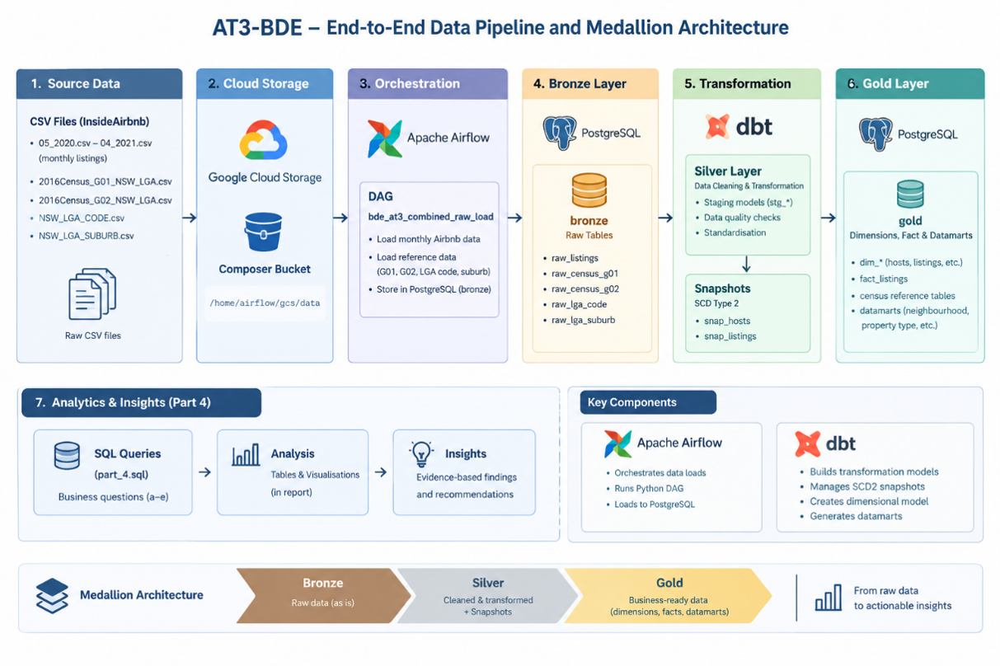
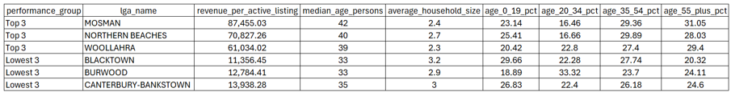
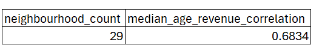
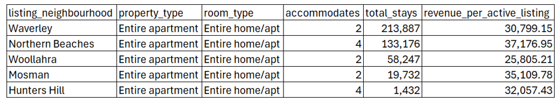
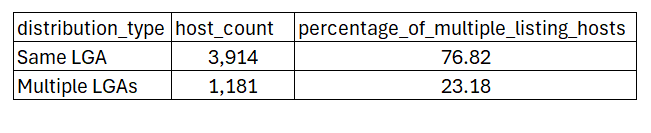
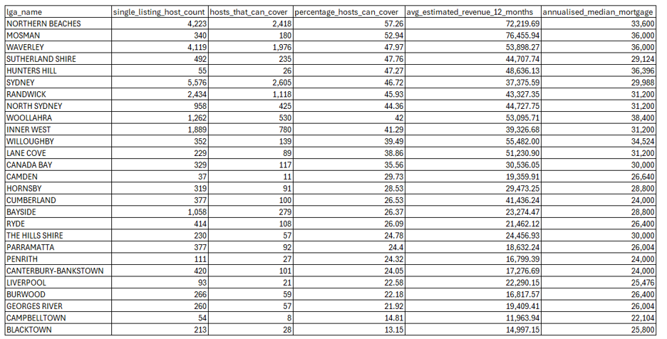

# Pipeline Architecture & Business Analysis

## 1. End-to-End Data Pipeline

<!-- Add your pipeline diagram to the repository, for example at images/pipeline_architecture.png, then update the path below if needed. -->

*Figure: Google Cloud Storage → Apache Airflow → PostgreSQL Bronze → dbt Silver and SCD Type 2 snapshots → Gold warehouse and datamarts → SQL business analysis.*

### How the Pipeline Works

1. **Source preparation:** Collect 12 monthly Sydney Airbnb listing files (May 2020–April 2021), 2016 Census G01/G02 data, and two NSW LGA mapping files (16 CSVs in total).
2. **Cloud storage and ingestion:** Store the CSVs in the Google Cloud Composer bucket. A combined Apache Airflow DAG loads the initial Census/LGA reference files once and ingests Airbnb listings for each selected month into PostgreSQL's **Bronze** schema. The DAG replaces existing rows matching incoming `scraped_date` values to reduce duplicate ingestion on repeated runs.
3. **Silver transformations:** dbt standardises dates, suburb/LGA names and Census identifiers, and separates host, listing, location and property entities.
4. **Historical tracking:** dbt **SCD Type 2 snapshots** preserve historical versions of host and listing attributes, using `scraped_date` as the timestamp.
5. **Gold warehouse:** dbt builds four dimensions (`dim_host`, `dim_listing`, `dim_location`, `dim_property`), `fact_listings`, Census reference models and three analytical datamarts.
6. **Analysis:** PostgreSQL SQL queries combine Airbnb performance metrics with Census demographics and mortgage benchmarks to answer five business questions.

**Monthly execution:** The Airflow DAG was manually triggered for each monthly extract, followed by `dbt run --select path:models/silver`, `dbt snapshot`, and `dbt run --select path:models/gold` in that order. This is a working ELT implementation, but the Airflow-to-dbt execution sequence was not fully automated.

**Validation:** Both Bronze listings and the final Gold fact table contained **412,122 records**. Checks found **zero missing listing SCD IDs, host SCD IDs or property IDs** in the fact table.

## 2. Business Analysis

The following five analyses were conducted using SQL on the Gold warehouse and analytical datamarts. Revenue and stay measures are **estimates**, not verified bookings or realised earnings.

### 2.1 Top 3 vs Lowest 3 Performing LGAs and Demographics

**Question:** Which Sydney Local Government Areas (LGAs) had the highest and lowest estimated revenue per active listing, and how did their demographics compare?

LGAs were ranked by estimated revenue per active listing over the 12-month period, then compared using 2016 Census median age, household size and age-group distributions.

Higher-performing LGAs generally had older populations and smaller households. For example, **Mosman** had a median age of **42** and average household size of **2.4**, compared with **33** and **3.2** in **Blacktown**. These are descriptive associations, not evidence that demographics cause higher revenue.

### 2.2 Median Age and Airbnb Revenue Correlation

**Question:** Is median age associated with estimated Airbnb revenue per active listing?

Census median age at the LGA level was matched to Airbnb listing neighbourhoods, and Pearson's correlation was calculated across **29 neighbourhoods**.

- **Pearson correlation:** `r = 0.6834`
- **Interpretation:** A moderately strong positive association between LGA median age and neighbourhood estimated revenue per active listing.
- **Limitation:** Correlation does not imply causation; median age was measured at the LGA rather than individual-neighbourhood level.

### 2.3 Best Listing Types in the Top 5 Neighbourhoods

**Question:** Which combinations of property type, room type and guest capacity generated the highest total estimated stays in the five highest-revenue neighbourhoods?

The leading configuration in each selected neighbourhood was **Entire apartment / Entire home/apt**, accommodating **2–4 guests**.

**Interpretation:** Entire apartments were prominent by **total** estimated stays in the selected neighbourhoods. Higher totals may reflect more available listings and do not necessarily mean better performance per property.

### 2.4 Multi-Listing Hosts Across LGAs

**Question:** Do hosts with multiple listings concentrate their properties within one LGA or spread them across several LGAs?

Hosts with more than one distinct listing were classified by the number of LGAs in which their listings were located.

**Interpretation:** Geographical concentration was substantially more common than cross-LGA diversification. The dataset does not establish why hosts chose these locations.

### 2.5 Mortgage Coverage for Single-Listing Hosts

**Question:** In which LGA did the greatest share of single-listing hosts generate enough estimated annual Airbnb revenue to meet or exceed the LGA's annualised median mortgage repayment?

For hosts with exactly one distinct listing, estimated 12-month revenue was compared with the corresponding LGA's Census-based annualised median mortgage benchmark.

**Important:** The calculation uses **estimated gross Airbnb revenue**, excluding cleaning, maintenance, platform fees, taxes and other costs. It measures potential benchmark coverage, **not net profitability or actual mortgage affordability**.

## 3. Key Findings

| Area | Key finding |
|---|---|
| **Regional revenue** | Mosman ($87,455.03), Northern Beaches ($70,827.26) and Woollahra ($61,034.02) led in estimated revenue per active listing; Blacktown, Burwood and Canterbury-Bankstown ranked lowest. |
| **Demographics** | Median age and estimated revenue per active listing had a positive Pearson correlation of **0.6834** across **29** listing neighbourhoods; this is not a causal finding. |
| **Listing configuration** | **Entire apartment / Entire home/apt** for **2–4 guests** generated the most total estimated stays among configurations examined in the five selected high-revenue neighbourhoods. |
| **Host concentration** | **76.82%** of multi-listing hosts (3,914 of 5,095) held listings within a single LGA; **23.18%** operated across multiple LGAs. |
| **Mortgage benchmark** | **57.26%** of single-listing hosts in Northern Beaches (2,418 of 4,223) had estimated gross annual revenue at or above the LGA's annualised median mortgage benchmark. |
| **Data engineering outcome** | The completed pipeline retained **412,122** records in `fact_listings`, with no missing host SCD, listing SCD or property identifiers. |

## 4. Recommendations

| Focus area | Recommendation | Rationale |
|---|---|---|
| **Location and pricing strategy** | Use LGA-level estimated revenue performance to shortlist markets, then assess property prices, operating costs and local conditions before investment. | Strong differences were observed between the highest- and lowest-performing LGAs. |
| **Property configuration** | Evaluate entire apartments accommodating **2–4 guests**, while comparing occupancy, listing supply, pricing and operating costs. | This configuration led in total estimated stays within the five selected high-revenue neighbourhoods. |
| **Demographic context** | Combine Census demographic indicators with tourism demand, location and property characteristics; avoid using median age alone to predict revenue. | The age–revenue relationship was correlational and based on LGA-level demographics. |
| **Mortgage and profitability analysis** | Extend gross-revenue comparisons to include cleaning, maintenance, commissions, taxes and individual financing costs. | Meeting a median mortgage benchmark does not establish net profitability. |
| **Pipeline reliability and scalability** | Automate dbt runs and snapshots after successful Airflow ingestion; add dbt tests, monitoring and failure alerts. | Monthly ingestion and downstream dbt execution currently require manual intervention. |

---

*Analysis period: May 2020–April 2021. Demographic and mortgage reference data: 2016 Australian Census. All financial and stay-related Airbnb measures reported here are estimates derived from the project dataset.*
